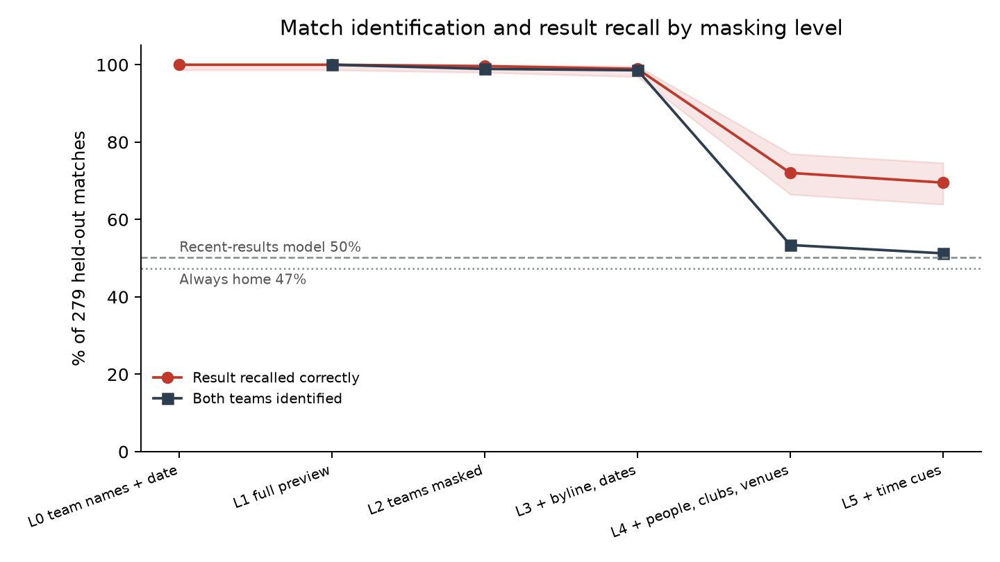

# Milestone 2 leakage study results

All tables use the saved output values as written. The probe asks the model to identify a historical match and predict its result from five versions of each preview.

## Leakage probe

| Level | n | Both teams identified | Season identified | Exact match identified | Result accuracy | Result accuracy 95% interval | Log loss | Result accuracy when identified | Result accuracy when not identified |
| --- | --- | --- | --- | --- | --- | --- | --- | --- | --- |
| L0 | 279 | — | — | — | 1.0 | [0.9864178395257276, 1.0] | — | — | — |
| L1 | 279 | 1.0 | 1.0 | 1.0 | 1.0 | [0.9864178395257276, 1.0] | 0.0247997652063787 | 1.0 | — |
| L2 | 279 | 0.989247311827957 | 1.0 | 0.989247311827957 | 0.996415770609319 | [0.9799797125550332, 0.9993670313468536] | 0.0450074898230458 | 1.0 | 0.6666666666666666 |
| L3 | 279 | 0.985663082437276 | 0.996415770609319 | 0.985663082437276 | 0.989247311827957 | [0.968867981311279, 0.9963365713429272] | 0.0671656989230063 | 1.0 | 0.25 |
| L4 | 279 | 0.5340501792114696 | 0.5949820788530465 | 0.5304659498207885 | 0.7204301075268817 | [0.6650476975055243, 0.7698246833606567] | 0.6101909966413706 | 1.0 | 0.4045801526717557 |
| L5 | 279 | 0.5125448028673835 | 0.5591397849462365 | 0.5017921146953405 | 0.6953405017921147 | [0.638981560687777, 0.7463931508115215] | 0.6479047565076327 | 1.0 | 0.3884892086330935 |

Recent-results model accuracy on the same matches: 0.5017921146953405. Always-home accuracy: 0.4731182795698925. [Source](summary.csv)

## Model comparison

| Family | Feature set | Original accuracy | Original log loss | Level 5 accuracy | Level 5 log loss |
| --- | --- | --- | --- | --- | --- |
| benchmark | always_home | 0.4731182795698925 | — | 0.4731182795698925 | — |
| benchmark | train_class_prior | 0.4731182795698925 | 1.0598966494615372 | 0.4731182795698925 | 1.0598966494615372 |
| logistic | baseline | 0.5017921146953405 | 1.0098406882907327 | 0.5017921146953405 | 1.0098406882907325 |
| logistic | llm_only | 0.4874551971326165 | 1.0476901380114179 | 0.4731182795698925 | 1.0624269692709356 |
| logistic | combined | 0.5125448028673835 | 1.0073535234554243 | 0.5232974910394266 | 1.0188359832874765 |
| logistic | baseline_plus_sentiment | 0.4982078853046595 | 1.0095936538632102 | 0.4982078853046595 | 1.0149707383887794 |
| logistic | baseline_plus_context | 0.5268817204301075 | 1.009249784505046 | 0.5197132616487455 | 1.0152287726994964 |
| random_forest | baseline | 0.4946236559139785 | 1.0182324483198342 | 0.4946236559139785 | 1.0182324483198342 |
| random_forest | llm_only | 0.4731182795698925 | 1.0487264515854575 | 0.4731182795698925 | 1.0555311969625922 |
| random_forest | combined | 0.5017921146953405 | 1.0184920190599303 | 0.4731182795698925 | 1.0278478102444764 |

[Original metrics](../full/metrics.csv) · [Level 5 metrics](../full_L5/metrics.csv)

## Combined minus baseline logistic log loss

| Run | Difference | 95% interval |
| --- | --- | --- |
| Original | -0.002487164835308291 | [-0.014480825615668297, 0.008975314257143551] |
| Level 5 | 0.008995294996743794 | [-0.003129703365616865, 0.02065569824946385] |

Negative differences favor the combined model. The intervals are exploratory calendar-week block bootstrap intervals. [Original comparison](../full/paired_comparisons.json) · [Level 5 comparison](../full_L5/paired_comparisons.json)

## Unknown feature values

| Feature | Original unknown share | Level 5 unknown share |
| --- | --- | --- |
| home_sentiment | 0.1426543647977289 | 0.15259048970901348 |
| home_form | 0.33924769339957417 | 0.33144073811213626 |
| home_availability | 0.7877927608232789 | 0.8005677785663591 |
| home_motivation | 0.6671398154719659 | 0.6706884315117104 |
| home_managerial_uncertainty | 0.9141234918381831 | 0.915542938254081 |
| away_sentiment | 0.22711142654364797 | 0.23633782824698368 |
| away_form | 0.42938254080908445 | 0.42938254080908445 |
| away_availability | 0.8665720369056068 | 0.8708303761533002 |
| away_motivation | 0.7061745919091554 | 0.7132718239886444 |
| away_managerial_uncertainty | 0.9524485450674237 | 0.9510290986515259 |

[Original coverage](../quality/full/feature_coverage.csv) · [Level 5 coverage](../quality/L5/feature_coverage.csv)

## Masking audit

The audit reports the share of previews where each cue remains. Level 4 intentionally retains weekdays and months; Level 5 removes them. The older handoff instruction requiring zero for that Level 4 row contradicted the masking design and has been corrected in the study guide.

| Check | L1 | L2 | L3 | L4 | L5 |
| --- | --- | --- | --- | --- | --- |
| calendar date | 0.032 | 0.032 | 0.0 | 0.0 | 0.0 |
| home/away team name | 0.989 | 0.0 | 0.0 | 0.0 | 0.0 |
| known person | 0.999 | 0.999 | 0.963 | 0.0 | 0.0 |
| other club | 0.603 | 0.603 | 0.603 | 0.0 | 0.0 |
| place | 0.374 | 0.265 | 0.265 | 0.0 | 0.0 |
| stadium | 0.404 | 0.398 | 0.398 | 0.0 | 0.0 |
| weekday or month | 0.397 | 0.397 | 0.378 | 0.376 | 0.0 |
| year | 0.1 | 0.1 | 0.0 | 0.0 | 0.0 |

[Masking audit source](../masking/residual_counts.csv) · [Masking-level definitions](../../docs/MASKING.md)

## Run details

The [probe manifest](probe.manifest.json) records model `gpt-6.1-sol` and CLI `codex-cli 0.169.0-alpha.11.1`. Saved answer timestamps span 2026-11-20T15:07:12.141874-05:00 through 2026-11-20T18:17:59.154767-05:00 in America/New_York. The [Level 5 extraction summary](../quality/L5/extraction_summary.json) records 1409 previews; the tagged model run used `human-validation omitted`.

Earlier attempts stopped on Codex transport 503, a usage-limit response, and a 401 authentication response; the scripts resumed from saved records. A Level 5 probe batch timed out at 300 seconds and was later completed using a 600-second timeout. The model, prompt, seed, batch size, and masking remained unchanged. The club-name scorer was corrected as described below; the saved model answers were not changed.

The first scoring run reported 35 unmapped team guesses, most of them formal names such as "Arsenal Football Club" and "Hull City Association Football Club" that the scorer did not recognise, so correct identifications were counted as wrong. The scorer was corrected on 2026-11-23 to strip "Football Club", "Association Football Club" and "F.C." before matching, and rerun on the same saved answers; no model calls were repeated. The table above uses the corrected scores. The remaining 10 unmapped guesses are clubs that were not in the 2017-18 Premier League (Blackburn Rovers, Blackpool, Bolton Wanderers, Brentford, Reading, Wigan Athletic, Wolverhampton Wanderers), so they are genuinely wrong. Result accuracy and log loss do not depend on team names and are unchanged.

## Interpretation

Masking team names, years, dates and bylines (Levels 2-3) barely changes anything: the model still names both teams for about 99% of matches and recalls about 99% of results. Masking people, other clubs, stadiums and places (Level 4) roughly halves identification, to 53%, and Level 5 time cues reduce it only slightly further, to 51%. Result accuracy falls to 72% and 70%, which remains well above the recent-results model (50%) on the same matches. At every level the model got the result right for every match it identified (100%); for matches it did not identify at Levels 4-5, its accuracy was 39-41%, below the recent-results model. The original combined logistic model had a slightly lower log loss than its baseline; the Level 5 combined model had a higher log loss than its baseline. Both 95% intervals for that difference include zero.
